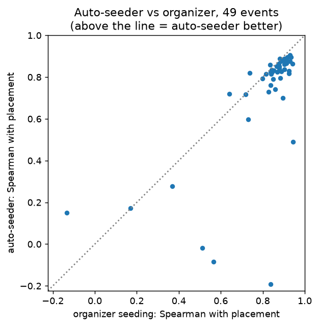

# Auto-seeder validation

Generated 2026-11-08 12:37. 49 events from 2026-01-01 onward, 9,818 entrants. Each event is seeded using only information from before it (ratings from before that week, a matchup model fitted on pre-2026 games, and each player's pre-2026 main). About 74% of entrants had a known main.

## Results

Mean over events, 95% bootstrap interval in brackets.

| method | seed vs placement (Spearman) | top-8 seeds in top 8 | sets won by better seed |
| --- | --- | --- | --- |
| organizer | 0.808 [0.743, 0.858] | 5.35 [5.00, 5.67] | 0.793 [0.766, 0.813] |
| ratings only | 0.726 [0.649, 0.793] | 5.20 [4.78, 5.59] | 0.772 [0.744, 0.795] |
| ratings + characters | 0.725 [0.641, 0.796] | 5.24 [4.84, 5.61] | 0.771 [0.745, 0.796] |
| random | -0.001 [-0.007, 0.004] | 0.44 [0.38, 0.51] | 0.499 [0.498, 0.501] |

Best Spearman: **organizer**.

## Head-to-head

Per-event difference (first method minus second), with the number of events each way.

| comparison | Spearman difference | top-8 difference | set-accuracy difference |
| --- | --- | --- | --- |
| ratings + characters vs organizer | -0.083 [-0.141, -0.033]; better in 6, worse in 43 | -0.102 [-0.367, +0.163]; better in 9, worse in 11 | -0.022 [-0.042, -0.003]; better in 18, worse in 30 |
| ratings only vs organizer | -0.082 [-0.139, -0.033]; better in 8, worse in 41 | -0.143 [-0.429, +0.143]; better in 8, worse in 11 | -0.021 [-0.042, -0.003]; better in 18, worse in 30 |
| ratings + characters vs ratings only | -0.001 [-0.001, +0.000]; better in 20, worse in 27 | +0.041 [-0.041, +0.143]; better in 4, worse in 2 | -0.001 [-0.002, +0.001]; better in 16, worse in 19 |

## Newcomers

Share of sets won by the better seed, split by whether a player with fewer than 5 prior sets was involved.

| sets | organizer | ratings only | ratings + characters |
| --- | --- | --- | --- |
| established players only | 0.815 | 0.82 | 0.82 |
| involves a newcomer | 0.783 | 0.639 | 0.639 |

## Reading these numbers

- **Placement favours the organizer.** The organizer's seeding decides the bracket, so it decides who meets whom and which placements are reachable. A seeding that was never used is judged against a bracket built on another seeding. Set accuracy is less affected than Spearman or top-8.
- **Organizers know things the data doesn't**: recent online results, regional reputation, players from outside the US data. Roughly matching them from tournament data alone shows the model has real competency.
- Per-event results: `reports/tables/seeding_per_event.csv`.