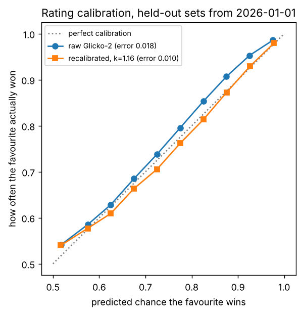

# Validation and robustness report

Generated 2026-11-18 11:18 from `data/processed` and `data/models`. Held-out period: sets from 2026-01-01.

| Check | Result | Value |
| --- | --- | --- |
| Raw Glicko-2 probabilities calibrated (mean error < 0.02) | pass | 0.018 |
| Recalibrated probabilities calibrated (mean error < 0.02) | pass | 0.010 (k = 1.16) |
| Results insensitive to Glicko tau (log-loss spread < 0.005) | pass | 0.00001 |
| Characters improve held-out predictions (bootstrap CI above 0) | pass | 0.0016 [0.0014, 0.0019] |
| Player-on-character term improves held-out predictions (bootstrap CI above 0) | pass | 0.0057 [0.0052, 0.0063] |
| Character ranking reproducible across random halves (Spearman > 0.8) | pass | 0.89 |

## 1. Rating calibration

Held-out sets (from 2026-01-01) grouped by the favourite's predicted chance. Raw Glicko-2 probabilities are **underconfident (favourites win more often than predicted)**: weighted mean error 0.018. Scaling the log-odds by k = 1.16, fitted only on the two years before the test period, brings the error to **0.010**. The dashboard is unaffected (its matchup model learns its own scale from the data); the auto-seeder should use the recalibrated probabilities.

| favourite's predicted chance | sets | raw predicted | raw observed | recal. predicted | recal. observed |
| --- | --- | --- | --- | --- | --- |
| 0.50-0.55 | 25414 | 0.518 | 0.541 | 0.517 | 0.540 |
| 0.55-0.60 | 18058 | 0.575 | 0.585 | 0.575 | 0.577 |
| 0.60-0.65 | 18409 | 0.625 | 0.628 | 0.625 | 0.609 |
| 0.65-0.70 | 18544 | 0.675 | 0.685 | 0.675 | 0.663 |
| 0.70-0.75 | 17845 | 0.725 | 0.738 | 0.725 | 0.706 |
| 0.75-0.80 | 17694 | 0.775 | 0.795 | 0.775 | 0.762 |
| 0.80-0.85 | 17951 | 0.825 | 0.853 | 0.825 | 0.814 |
| 0.85-0.90 | 18916 | 0.875 | 0.907 | 0.876 | 0.873 |
| 0.90-0.95 | 19833 | 0.925 | 0.953 | 0.926 | 0.929 |
| 0.95-1.00 | 21808 | 0.976 | 0.986 | 0.978 | 0.980 |

## 2. Where the ratings work

Every prediction uses only ratings from before that week, so each year is out-of-sample. Early years are weaker because nobody has a rating history yet.

**By year (all sets):**

| year | sets | accuracy | log_loss |
| --- | --- | --- | --- |
| 2019 | 589125 | 0.667 | 0.561 |
| 2020 | 190288 | 0.637 | 0.555 |
| 2021 | 336030 | 0.739 | 0.506 |
| 2022 | 485982 | 0.751 | 0.486 |
| 2023 | 432169 | 0.761 | 0.474 |
| 2024 | 308228 | 0.759 | 0.473 |
| 2025 | 247698 | 0.764 | 0.467 |
| 2026 | 194472 | 0.758 | 0.472 |

**By event size (sets from 2026):**

| size_bucket | sets | accuracy | log_loss |
| --- | --- | --- | --- |
| 32-63 | 133608 | 0.752 | 0.480 |
| 64-127 | 34572 | 0.759 | 0.467 |
| 128-255 | 13456 | 0.759 | 0.456 |
| 256-511 | 3687 | 0.817 | 0.400 |
| 512-1023 | 4346 | 0.790 | 0.426 |
| 1024+ | 4803 | 0.820 | 0.399 |

**By player experience (sets from 2026):**

| prior sets (less experienced player) | sets | accuracy | log_loss |
| --- | --- | --- | --- |
| 0-4 | 40496 | 0.607 | 0.621 |
| 5-19 | 22295 | 0.824 | 0.387 |
| 20-99 | 46083 | 0.820 | 0.397 |
| 100+ | 85598 | 0.778 | 0.463 |

## 3. Glicko-2 sensitivity

Held-out accuracy for different volatility settings (the model uses tau = 0.5). Log-loss spread across settings: **0.00001**.

| tau | sets | accuracy | log_loss |
| --- | --- | --- | --- |
| 0.3 | 194472 | 0.7577 | 0.47154 |
| 0.5 | 194472 | 0.7577 | 0.47154 |
| 0.8 | 194472 | 0.7577 | 0.47154 |
| 1.2 | 194472 | 0.7577 | 0.47155 |

## 4. Do characters add predictive value?

Fit on games before 2026-01-01, scored on 309,922 later games from 1,731 events. Confidence interval from 500 bootstrap resamples of whole events.

| | log loss | accuracy |
| --- | --- | --- |
| ratings only | 0.5701 | 0.694 |
| ratings + characters | 0.5685 | 0.697 |
| ratings + characters + player-on-character | 0.5627 | 0.700 |

Log-loss gain from characters: **0.0016** (95% CI 0.0014 to 0.0019). The gain is small but reliably above zero.

Further gain from the player-on-character term (how familiar each player is with the character they picked, plus how much better or worse they do on it than on their other characters): **0.0057** (95% CI 0.0052 to 0.0063).

Games where a player is on a character that makes up under half of their earlier games (107,971 games, 35% of the test set), accuracy: ratings only 0.705, + characters 0.706, + player-on-character 0.710.

## 5. Is the character-strength ranking stable?

The skill-adjusted character strengths (the data-driven tier list) refitted on different slices of the data. High correlation between random halves means the ranking is not noise; a lower before/after-2025 correlation can reflect genuine meta change (patches ended in 2021, but play styles kept evolving).

| comparison | spearman | top10_overlap |
| --- | --- | --- |
| random half A vs half B (by event) | 0.89 | 6 / 10 |
| before 2025 vs 2025 onward | 0.71 | 5 / 10 |
| penalty 10/100 vs 100/1000 | 0.91 | 8 / 10 |

Full per-split strengths: `reports/tables/strengths_by_split.csv`.
